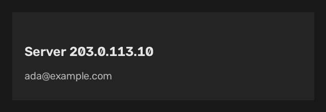
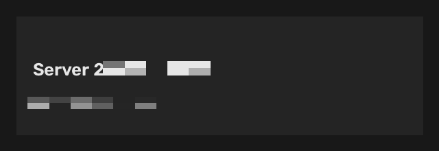

# LeakLens

LeakLens scans a photo or video on your machine, flags likely secrets, and writes a redacted copy plus an HTML review report. Frames and extracted text are not uploaded.

It is a high-recall review tool. A value that appears in one frame is treated as a leak. It will miss some text, and it will sometimes redact more than you wanted. Inspect `review.html` before you share the output.

## Install

Python 3.10 or newer. [ffmpeg](https://ffmpeg.org/) on `PATH` is optional and keeps audio in redacted video.

```bash
python -m venv .venv
.venv\Scripts\activate
pip install -e .
leaklens --version
```

On macOS or Linux, activate with `source .venv/bin/activate`.

The first scan that looks for faces downloads the YuNet face model from the OpenCV model zoo into `src/leaklens/assets/` if it is not already there. That file stays on disk. The photo or video itself is not sent anywhere. Set `detect_faces: false` in a config file to skip the download.

## Usage

```bash
leaklens shot.png
leaklens demo.mp4
leaklens demo.mp4 -o demo.redacted.mp4
leaklens demo.mp4 --strict --review
leaklens demo.mp4 --json findings.json
leaklens serve
```

`leaklens serve` opens `http://127.0.0.1:8765`. Uploads are processed in a temporary directory on this machine. Binding another host makes that page reachable from the network.

Default files, next to the input:

```text
shot.redacted.png
demo.redacted.mp4
demo.leaklens/review.html
demo.leaklens/detections.json
```

The original file is not modified.

| Flag | Description |
|---|---|
| `path` | Photo or video to scan. |
| `serve` | Local upload page. |
| `-o`, `--output` | Redacted file, or a directory. |
| `--json FILE` | Also write `detections.json` to `FILE`. |
| `--strict` | Scan every frame, including inverted and sharpened OCR. |
| `--review` | Open `review.html` when the scan finishes. |
| `--config FILE` | YAML overrides. Start from `config.example.yaml`. |
| `--cpu` | Force CPU even when a GPU is available. |
| `--benchmark` | Print per-stage timings. |
| `-q`, `--quiet` | No banner or progress. |
| `-v`, `--version` | Print the version. |

```text
[!] IPv4 address detected
    00:04.183 → 00:09.516
[+] Redactions:  1
[+] Output:      demo.redacted.mp4
[+] Report:      demo.leaklens/review.html
```

Exit codes: `0` success, `1` error or interrupt, `2` bad arguments, `3` unsupported media, `4` detection failure, `5` export failure. Ctrl+C deletes an incomplete `.partial` video.

## What gets redacted

OCR text is classified before anything is blurred. Matches include public and private IP addresses, GPS coordinates, email addresses, phone numbers, MAC addresses, API keys, tokens, JWTs, password values, private keys, cloud credentials, database URLs, home-directory usernames, and identifying hostnames.

A command with no secret in it stays visible. In `curl https://192.168.1.50/api`, only the address is blurred. A secret in a single frame is still a leak. Tracking holds the box across nearby frames until the value is gone.

## Example

These frames are generated. The address is from the documentation range in RFC 5737, not a capture of a real machine.





## Architecture

```text
src/leaklens/
    cli.py            command line, progress, exit codes
    web.py            local upload page
    scanner.py        scan entry point
    pipeline.py       frame loop
    detectors/        regex, layout heuristics, faces, QR codes
    ocr.py            RapidOCR
    tracking.py       hold a leak across nearby frames
    render.py         redacted photo or video
    report.py         detections.json and review.html
    config.py         YAML overrides
```

## Configuration

Copy `config.example.yaml` and pass it with `--config`. OCR dumps and review crops are off by default. They contain the text LeakLens found. Turn them on only while debugging a file, then delete the report directory.

`config.pii-tight.yaml` is a stricter blur profile. It does not enable those dumps.

## Development

```bash
pip install -e ".[dev]"
python -m unittest discover -s tests -p "test_*.py" -v
ruff check src tests
python tests/synthetic_eval.py
```

`synthetic_eval.py` writes an OCR transcript next to each generated clip and scores the detector against that transcript. When every planted string is matched, the script prints that sensitive-information recall was 1.0 and that the result is not production-ready. That score is the rules matching supplied text. It does not measure whether OCR read the pixels.

A separate check on this machine drew `10.1.2.3` and a synthetic token onto one frame of an eight-frame clip and scanned the file with the real OCR engine. Both strings were found. During that scan, and during the unit tests, OpenCV printed `Targets are not supported by the new graph engine for now` while the face detector loaded. The runs still finished.

## Limitations

- Missed text, odd fonts, motion blur, and reflections can hide a secret.
- Ordinary words are sometimes redacted when they look like a name, host, or token.
- Face detection depends on the YuNet model and will miss faces.
- The review report and any enabled crops are as sensitive as the source. Do not publish them.
- This is not a certified redaction process. Look at the report before you share the file.

## License

MIT. See [LICENSE](LICENSE).
